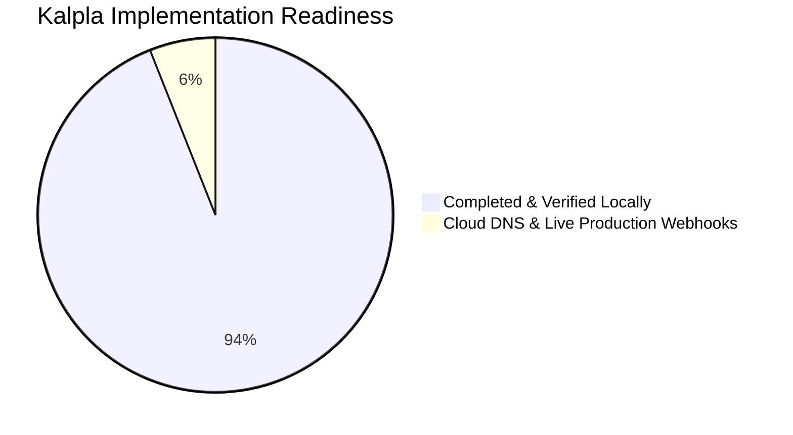

# Kalpla — The GenAI Engineering Operating System

> **Diagnostic-driven, adaptive mastery platform for Senior GenAI & Autonomous Agent Architects.**  
> Built with Next.js 16 (App Router + Turbopack), TypeScript, Supabase, Monaco Editor, Daily.co, and Stripe.

---

## 📊 Project Status: Pre-Deployment Stage (~94% Complete)

For the detailed visual showcase, architecture breakdown, and full gallery of **33 live screenshots** captured across the platform, see:

👉 **[docs/PROJECT_STAGE.md](docs/PROJECT_STAGE.md)**



---

## ⚡ Core Features

- **Diagnostic-First Adaptive Roadmap**: Automated skill gap evaluation assessing candidate readiness across LLM fundamentals, RAG vector search, agent loops, and evaluation harnesses.
- **In-Browser Monaco & Pyodide IDE**: Real-time Python execution sandbox with automated test runner, multi-level hint ladder, and reference solutions.
- **Interactive Curriculum & AI Tutor**: Concept deep-dives, code examples, "Check Understanding" interactive comprehension quizzes, and contextual AI tutoring.
- **Verified Public Portfolio**: Cryptographically grounded competency badge and published engineering case studies accessible via shareable vanity URLs (e.g. `/portfolio/username`).
- **Live Video Cohorts & Workshops**: Integrated Daily.co video rooms with attendance tracking and strict capacity controls (20-seat cap).
- **Comprehensive Admin Control Suite**: User fleet directory, markdown curriculum authoring with version history, skill graph health telemetry, live session room manager, AI token cost analytics, and AI grading review escalation queue.
- **Multi-Tier Stripe Billing**: Tier usage meters, soft-cap warning banners, and customer self-service billing portal.

---

## 🛠️ Tech Stack

- **Framework**: [Next.js 16 (App Router + Turbopack)](https://nextjs.org/)
- **Language**: TypeScript 5
- **Styling**: Tailwind CSS, CSS Grid telemetry backgrounds, custom glassmorphism
- **Database & Auth**: [Supabase](https://supabase.com/) (PostgreSQL with Row Level Security, SSR Cookies)
- **Editor & Sandbox**: Monaco Editor (`@monaco-editor/react`) + Pyodide in-browser Python runtime
- **Video Infrastructure**: [Daily.co](https://www.daily.co/) embedded video client (`@daily-co/daily-js`)
- **Payments**: Stripe Checkout & Customer Portal (`stripe`)
- **Testing**: Vitest (`vitest`) & Playwright (`@playwright/test`)
- **Monitoring**: Sentry (`@sentry/nextjs`)

---

## 🚀 Getting Started

### Prerequisites

- Node.js >= 20.9.0
- npm / pnpm / yarn

### Local Setup

1. **Clone the repository**:
   ```bash
   git clone https://github.com/jnaneshshetty51/Kalpla.git
   cd Kalpla
   ```

2. **Install dependencies**:
   ```bash
   npm install
   ```

3. **Configure environment variables**:
   ```bash
   cp .env.example .env.local
   ```
   Fill in your Supabase, OpenAI/Anthropic, Daily.co, and Stripe keys.

4. **Start the local development server**:
   ```bash
   npm run dev
   ```
   Open [http://localhost:3000](http://localhost:3000) in your browser.

5. **Run tests**:
   ```bash
   npm run test          # Unit test suite
   npm run test:e2e      # Playwright end-to-end tests
   ```

6. **Generate Showcase Screenshots**:
   ```bash
   node scripts/capture-showcase.mjs
   ```

---

## 📖 Documentation Directory

- [Project Stage & Visual Showcase](docs/PROJECT_STAGE.md) — Complete 33-screen platform tour and layer-by-layer status matrix.
- [Production Deployment Guide](docs/DEPLOYMENT.md) — Environment variables checklist, database migrations, and Vercel setup.
- [Pilot Launch Playbook](docs/pilot-launch/README.md) — Operational guidelines, curriculum roadmaps, and legal documents.

---

## 📄 License

Proprietary — All rights reserved © Kalpla 2026.
